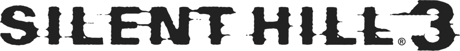

<div align=center>

<picture>
  <source media="(prefers-color-scheme: dark)" srcset="docs/logo.png">
  
</picture>

</div>
<h1 align=center>Silent Hill 3 — Nintendo Switch port</h1>

<p align=center><a href="https://discord.gg/H9yb3hSkvf"></a></p>

<p align=center><b>v0.03</b></p>

A native Nintendo Switch port of the PC version of **Silent Hill 3**, made the same way as
[sh2-nx](https://github.com/cutarev/sh2-nx).

It's not an emulator. The game's x86 executable is statically recompiled to C ahead of time and the C is compiled
for the Switch's ARM64 CPU. The Windows layer the game expects (Direct3D 8, DirectSound, DirectInput, kernel32...)
is reimplemented on top of SDL2 and OpenGL.

> [!NOTE]
> No game files are included. You need your own copy of the PC game; the NRO from
> [Releases](https://github.com/cutarev/sh3-nx/releases), or one you build yourself
> ([Building the NRO](#building-the-nro)), runs it.

## Features

- **Native code**: every function of `sh3.exe` runs as ARM64 code; no emulator, no Wine.
- **Widescreen**: 16:9 at 1280x720 by default, 1920x1080 for docked play, or the original 4:3
  (ThirteenAG's WidescreenFix, ported). The camera widens in gameplay, cutscenes keep their framing without the
  letterbox, and menus and HUD stay in a centered 4:3 area.
- **Controller**: Nintendo's layout (A confirms, B cancels), remappable in Options > Button Config.
- **Shader cache**: shaders are compiled once and kept on the SD card, so areas only stutter the first time.
- Also builds for Linux (x86-64), which is where most of the debugging happens.

## v0.03

- Better crash logs: `sh3-crash.log` lists the last calls of the thread that crashed (they were mixed from every
  thread), and with `log=1` in `sh3.ini`, `sh3.log` names any file the game fails to open.
- Fixed a crash entering the area past the Hazel Street station stairs (a monster callback that was never
  recompiled; another one like it fixed too).

## v0.02

- Heather's hair in the real-time cutscenes was drawn as solid blocks
  ([#1](https://github.com/cutarev/sh3-nx/issues/1)): the alpha of the game's paletted (P8) textures was dropped
  when they were expanded for OpenGL. The palette's alpha is now honored, and palettes are handled as Direct3D 8
  does (numbers up to 65535, a texture expanded again when its palette changes).

## v0.01

The first release: from the title screen into the game, with New Game, the opening, gameplay, the pause menu,
inventory, options and Button Config.

Known issues:

- The FMVs (`data/movie/*.000`, played through DirectShow on PC) are skipped.
- After the cutscene in the Office Building bathroom the screen can stay black: press a button to continue.
- The Konami and KCET logos and the credits are stretched on a wide screen.
- Little tested past the first areas: if it crashes, `sh3-crash.log` next to the NRO says where (please attach it
  to an issue).

## How to install

1. Install Silent Hill 3 on your PC. The port is built for the `sh3.exe` of 3,338,240 bytes, SHA-1
   `aa2aca6dba19bf510c9c2e92eefdc15e98266581`.
2. Copy to the SD card, with the card (or its folder) mounted on the PC:

   ```sh
   .venv/bin/python tools/make_sd.py /path/to/sd      # from a clone of this repository
   ```

   or by hand. Your `sh3-nx` folder should look like this:

   ```text
   /switch/sh3-nx/
     sh3-nx.nro       (from Releases)
     sh3.exe          (from your PC install)
     data/            (from your PC install, about 5 GB)
     savedata/        (an empty folder: saves and settings go here)
     sh3.ini          (optional, see Settings)
   ```

3. Launch it from the homebrew menu in **title takeover** mode (hold **R** while starting an installed game). Not
   from the album: applet mode does not give homebrew enough memory.

Saves, settings and the shader cache are written next to the NRO.

> [!CAUTION]
> The first time you enter an area its shaders are compiled, so **it can stutter for a moment**. They are kept in
> `sh3-progs.bin` and later visits are smooth.

## Controls

<div align="center">

| Switch | Xbox (PC) | Action |
| --- | --- | --- |
| A | A | Action, confirm |
| B | B | Flashlight, cancel |
| Y | X | Dash |
| X | Y | Map |
| L / R | LB / RB | Strafe left / right |
| ZL | LT | Ready weapon |
| ZR | RT | Search view |
| + | Start | Inventory |
| − | Back | Pause, skip |
| Left stick, d-pad | Left stick, d-pad | Move |
| Right stick | Right stick | Camera |
| L stick click | LS | Supplies |
| R stick click | RS | Zoom |

</div>

Laid out as in sh2-nx; change them in Options > Button Config. A `savedata/key.ini` saved by an older version keeps
its old layout: delete it to get this one. With a keyboard on PC: W A S D and Q E
to move and turn, Space for action, Return / Escape to confirm / cancel.

## Settings

`sh3.ini`, next to the NRO (every line is optional):

| Setting | Effect |
| --- | --- |
| `resolution=1280x720` | the default; `1920x1080` for docked play, `960x720` or `640x480` for the original 4:3 |
| `cores=1` | every game thread on one core, a fallback if the audio misbehaves |
| `log=1` | write `sh3.log` next to the NRO, for bug reports (off by default: it costs an SD card write per line). Crashes always go to `sh3-crash.log` |
| `trace=1` | with `log=1`, log every Windows call the game makes (very slow) |

## Building the NRO

You need the game (step 1 of [How to install](#how-to-install)): the code generator reads `sh3.exe`, applies the
widescreen patches to it and recompiles it.

Requirements: Python 3, CMake, Ninja, and for the Switch build podman (or a local devkitPro install with devkitA64,
libnx, switch-sdl2 and switch-mesa). For the Linux build, the SDL2 development files.

```sh
git clone https://github.com/cutarev/sh3-nx && cd sh3-nx
python3 -m venv .venv && .venv/bin/pip install -r requirements.txt
ln -s "/path/to/Silent Hill 3" game     # the folder holding sh3.exe and data/
tools/regen.sh                          # recompiles game/sh3.exe into src/recomp/gen (~5 min)

tools/build-switch.sh                   # -> build/switch/sh3-nx.nro (devkitPro's container under podman)
tools/build-switch-local.sh             # the same with a local devkitPro install

cmake -S . -B build/linux -G Ninja && cmake --build build/linux    # Linux build
build/linux/sh3 game
```

## How it works

- **The game's code is translated, not emulated.** `tools/regen.sh` wraps the PE as an XBE for
  [xboxrecomp](https://github.com/sp00nznet/xboxrecomp) (patched for these ports), which turns every function into C.
  `tools/seeds.py` finds the functions only data refers to, `tools/fix_functions.py` repairs the ones the
  disassembler cut short, and `tools/observed_seeds.txt` lists those found at run time.
- **Widescreen.** ThirteenAG's fix patches the running game; here its code changes are byte patches applied to the
  exe before recompiling (`tools/patch_exe.py`, each site checked against the original bytes) and hand-written
  functions in `src/game/sh3.c`.
- **The Windows layer.** Direct3D 8 runs on OpenGL with the shaders translated to GLSL (`src/d3d8`), DirectSound is
  a software mixer on SDL audio, DirectInput goes through SDL, and kernel32, user32 and winmm are in `src/win32`.
  `src/runtime` holds the guest memory, threads and the Linux/Horizon layer.

## Debugging aids (Linux)

| Variable | Effect |
| --- | --- |
| `SH3_KEYS="22:Return,30:Down+2"` | scripted key presses (seconds, key, optional hold); the window is hidden and the real keyboard ignored |
| `SH3_SHOW=1` | keep the window visible during a scripted run |
| `SH3_SHOT=dir`, `SH3_SHOT_EVERY=n` | dump frames as PPM (`tools/ppm2png.py`) |
| `SH3_STATS=1` | frame rate and guest heap |
| `SH3_TRACE=1` | log every bridged Windows call |
| `SH3_PEEK=va,...` / `SH3_POKE=frame:va=value` | log guest dwords every 60 frames / write one |
| `SH3_COVER=frame` / `-frame` | with a tracing build (`TRACE=$PWD/build/disasm/functions.json tools/regen.sh --recomp-only`), log the functions that run after that frame |
| `SH3_ORACLE=va,n` | differential test of one function against Unicorn (`tools/oracle.py`) |

A build with `-DRECOMP_ABI_CHECK` logs every call that returns with `esp`, `ebx`, `esi` or `edi` changed, on the
Switch too (`log=1`). `tools/fuzz.py` checks the lifter's instruction semantics against Unicorn.

## Credits

- **Konami and Team Silent**: creators of Silent Hill 3. This is an unofficial, fan-made port with no affiliation.
- **[WidescreenFixesPack](https://github.com/ThirteenAG/WidescreenFixesPack)** by ThirteenAG (MIT): the widescreen
  fix.
- **[sh2-nx](https://github.com/cutarev/sh2-nx)**: the runtime this port starts from.
- **[xboxrecomp](https://github.com/sp00nznet/xboxrecomp)** by sp00nznet: the x86 to C lifter.
- **nfsmw-nx**, the Need for Speed: Most Wanted Switch port, for the Horizon guest-memory technique.
- **[devkitPro](https://devkitpro.org) and [switchbrew](https://github.com/switchbrew/libnx)**, SDL2, Mesa.

## Legal

Silent Hill is a trademark of Konami. This project is not affiliated with Konami. This repository contains no assets
or program code from the original game; users must provide their own copy. Running homebrew requires custom firmware.
